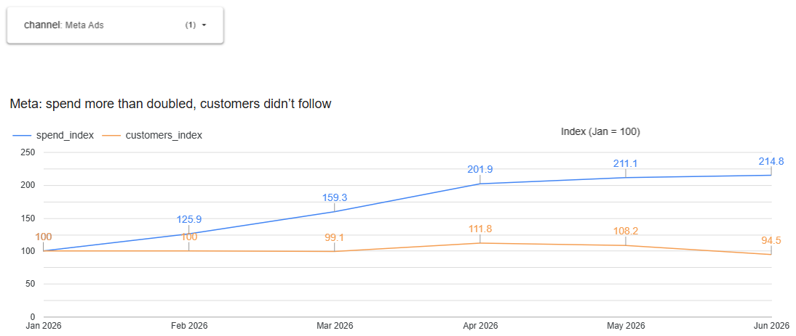
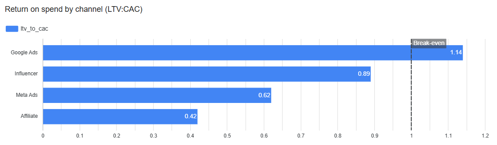
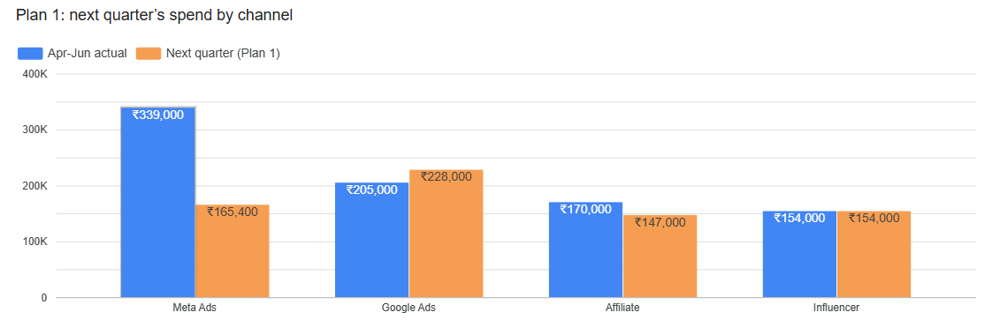

# Part 2 Memo: cutting paid spend 20%

**Decision.** Cut Meta Ads by ₹173,600 a quarter (−51%), move ₹23,000 from Affiliate to Google Ads, and leave Influencer unchanged. Together this saves 20% of last quarter's ₹868,000 paid spend (C3).

**Why Meta.** February–April, Meta's spend rose about 26% each month, but its new customers didn't follow (0%, −1%, +13%). By May, spend was up 111% on January; customers were up 8%. Every other channel's customers moved with its spend (C1).

**Shift and protect.** Google Ads has the best return: LTV:CAC 1.14, the only channel above break-even (C2). Raise it only to its highest tested month, ₹76K, where its CAC held. Google beats Influencer because it returns more per rupee now (1.14 vs 0.89) and has been tested at higher spend. Affiliate has the lowest-value customers (₹957 each, 8% repeat), so we trim it. Influencer stays: its customers are worth the most (₹2,858, 73% repeat), earning back its high CAC.

**Expected impact.** An estimated 22–210 fewer customers a quarter, depending on how Meta responds; the month-on-month evidence points to the low end.

**Risk and what we'll watch.** Removing extra spend might lose more customers than adding it gained. We'll track weekly new customers and CAC for Meta, Google and Organic against the April–May baseline. If total new customers fall more than 10% for three weeks running, we restore part of Meta's budget.

**Caveats.** Assumes a flat 30% margin for every channel. We removed 35 internal test accounts that had inflated Affiliate's revenue.

---

## Charts

*Built in Looker Studio from `outputs/charts/data/` (exported by `sql/28_export_chart_data.sql`). Charts and captions are not part of the 250-word memo.*

**C1: Meta's spend more than doubled; its new customers didn't follow.** Both lines are indexed to January = 100. June's customer figure is understated because June signups have had less time to buy.

**C2: Return on spend (LTV:CAC) by paid channel.** Google Ads is the only channel above break-even (1.0).

**C3: Plan 1: next quarter's spend by channel vs April–June.**

