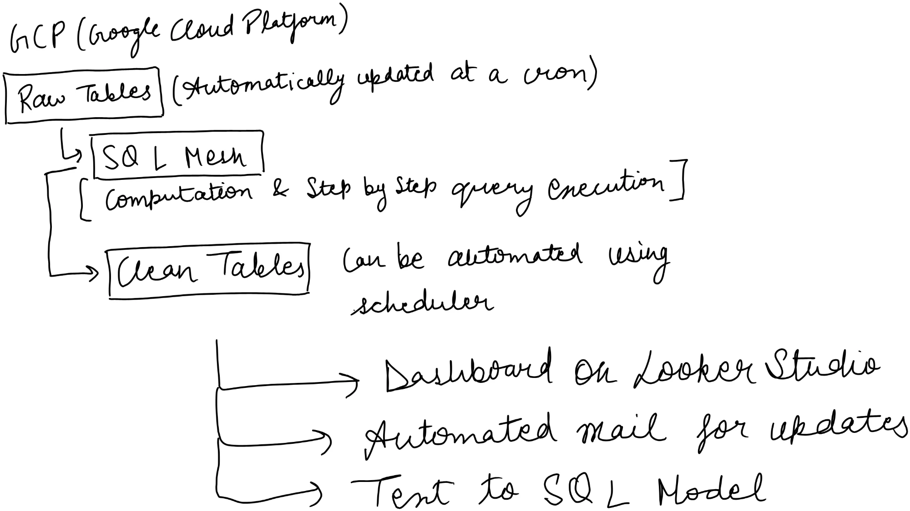

# Part 3: Automation and self-serve design

## A. Pipeline (GCP)

**1. Collect into Raw Tables.** Data from GA4, Google Ads, Salesforce, Meta Ads, MoEngage and an Affiliate/Influencer spend sheet lands untouched in BigQuery Raw Tables, via Google's built-in exports and ready-made connectors.

**Scheduling depends on use.** Jobs run on cron (Cloud Scheduler on GCP): every 0.5–2 hours in office hours for operational reporting, once or twice a day for monthly reporting like this. Airflow (Cloud Composer) can orchestrate as pipelines grow.

**2. Clean with SQLMesh.** Every Part 1 query becomes a SQLMesh model, run step by step after each refresh: Raw Tables → Clean Tables (deduplication, test-account removal, Unknown-channel flag) → metric queries (CAC, LTV:CAC, monthly trend). The same filters apply on every run, so Part 1's issues can't carry forward.

**3. Check.** SQLMesh audits encode every Part 1 issue: unique order_id (206 duplicates found), no internal emails (35 test accounts), valid statuses only, no orphan orders, complete spend, and Clean = Raw minus excluded rows. A failed audit blocks publishing; the dashboard keeps the last good numbers.

**Security and errors.** API keys sit in Secret Manager (Google's password manager for code), never in code. Pipeline errors and failed audits are summarised by AI into a maintenance email to the data team, with the raw error attached.

## B. Self-serve (reads Clean Tables only)

**4. Show.** A Looker Studio dashboard (CAC, LTV:CAC, new customers by channel and month) and a scheduled update email.

For one-off questions ("What was Meta's CAC last month?"), a text-to-SQL assistant writes a fresh query every time, guided by our catalog:
1. Every table and what one row means.
2. Every column: meaning, type and allowed values.
3. Every metric's standard SQL definition (CAC, LTV:CAC, repeat rate) plus filtered variations (by month, Jan–May cohorts, one channel).

It adapts the closest definition, then:
- A check rejects queries that drop mandatory rules (delivered only, test accounts and Unknown excluded) or read beyond Clean Tables.
- Answers use only the result and state the definition, period, "data as of" and SQL.
- Any number not in the result is blocked. Unanswerable questions get "I can't answer that" (e.g. Organic CAC: no spend).

**Testing before launch:** 50 questions (with variations and rephrasings) whose answers come from our verified SQL must all match; trick questions (unknown channels, future months) must be refused. Catalog changes rerun the set, then a two-week analyst-checked pilot.
